# 校园博客系统

> 🎓 **计算机毕业设计 · 校园博客系统**
>
> 本仓库只放**项目介绍 + 运行截图**（截图是站点带水印的原图，存在仓库 `images/` 里）。
>
> 👉 **完整可运行源码 / 数据库脚本 / 部署文档：[点我获取](https://geekcode.top/archives/%E6%A0%A1%E5%9B%AD%E5%8D%9A%E5%AE%A2%E7%B3%BB%E7%BB%9F?utm_source=github)**
>
> 💬 咨询微信：**ir9372**　|　🌐 更多项目：[极客代码 geekcode.top](https://geekcode.top/?utm_source=github)
>
> 📌 项目详情页：<https://geekcode.top/archives/%E6%A0%A1%E5%9B%AD%E5%8D%9A%E5%AE%A2%E7%B3%BB%E7%BB%9F?utm_source=github>

<table><td width="230" align="center"> <b>扫码加微信 ir9372</b></td><td valign="middle">📦 源码 = 项目介绍 + 全部运行截图 + 数据库 + 部署文档 👉 点上方任意截图，直接跳到 <b>极客代码 geekcode.top</b> 详情页</td></table>

---

<h1>校园博客系统</h1>
<h2>项目概述</h2>

本项目为“校园博客系统”，旨在构建一个集内容发布、互动评论、分类管理及后台运维于一体的综合性Web应用平台。系统采用前后端分离架构，面向校园用户群体，提供文章浏览、个人中心管理、我的收藏及在线交流等服务。核心功能涵盖前台的文章信息展示、系统公告查阅、评论互动以及博主入驻；后台则实现对文章、分类、评论、举报投诉、在线客服及系统配置的全方位管理。技术栈基于 Spring Boot 框架，结合 MyBatis-Plus 进行高效数据持久化操作，并引入 Apache Shiro 实现安全认证与授权机制。该项目适用于高校内部的知识分享社区建设，能够有效促进师生间的学术交流与信息互通，提升校园信息化管理水平。

<h2>技术架构</h2>

本系统采用经典的前后端分离模式，后端基于 Java 语言开发，前端采用 Vue.js 框架构建单页应用（SPA），通过 RESTful API 进行数据交互。

<strong>后端架构：</strong>
核心框架选用 Spring Boot，利用其自动配置特性简化开发流程。持久层采用 MyBatis-Plus，在 MyBatis 的基础上增强 CRUD 操作效率，支持 Lambda 表达式查询，减少样板代码。安全模块集成 Apache Shiro，负责用户身份认证（Authentication）和访问控制（Authorization），确保系统数据的安全性。数据库连接使用 MySQL Connector/J，配合 Spring JDBC 进行事务管理。

<strong>前端架构：</strong>
前端项目类型为 <code>vue-integrated</code>，表明采用了 Vue 生态体系。通过 Axios 等 HTTP 客户端向后端发起请求，实现页面动态渲染。界面设计注重用户体验，区分了前台用户视图和后台管理员视图。

<strong>核心技术选型理由：</strong>

<ol>
<li><strong>Spring Boot</strong>: 快速搭建企业级应用，内置 Tomcat，部署便捷。</li>
<li><strong>MyBatis-Plus</strong>: 相比原生 MyBatis，大幅降低 SQL 编写复杂度，提高开发效率。</li>
<li><strong>Shiro</strong>: 轻量级且强大的安全框架，适合中小型项目的权限控制需求，易于集成。</li>
<li><strong>Vue.js</strong>: 响应式数据绑定和组件化开发，提升了前端页面的可维护性和加载速度。</li>
</ol>
<h2>功能模块</h2>

根据源码 Controller 列表及截图功能描述，系统主要划分为前台用户端和后台管理端两大模块。

<h3>前台用户端</h3>

前台导航包含“文章信息”和“系统公告”，个人中心包含“个人中心”和“我的收藏”。具体功能如下：

<ol>
<li><strong>用户注册与登录</strong></li>
</ol>
<ul>
<li>提供新用户注册入口及现有用户登录界面，保障账户安全性。</li>
</ul>
<ol start="2">
<li><strong>首页展示</strong></li>
</ol>
<ul>
<li>展示系统概览，可能包含热门内容或最新公告入口。</li>
</ul>
<ol start="3">
<li><strong>文章信息管理</strong></li>
</ol>
<ul>
<li><strong>文章列表</strong>：浏览所有公开的文章信息。</li>
<li><strong>文章详情</strong>：查看特定文章的完整内容及元数据。</li>
<li><strong>文章评论</strong>：在文章详情页下方查看已有评论列表，并进行新评论的提交。</li>
<li><strong>评论详情</strong>：查看单条评论的具体信息及回复情况。</li>
</ul>
<ol start="4">
<li><strong>系统公告管理</strong></li>
</ol>
<ul>
<li><strong>公告列表</strong>：浏览发布的系统通知或新闻。</li>
<li><strong>公告详情</strong>：阅读具体的公告全文。</li>
</ul>
<ol start="5">
<li><strong>个人中心</strong></li>
</ol>
<ul>
<li><strong>个人信息</strong>：查看和编辑用户基本资料。</li>
<li><strong>我的收藏</strong>：查看用户收藏的文章列表，支持取消收藏。</li>
</ul>
<ol start="6">
<li><strong>互动与反馈</strong></li>
</ol>
<ul>
<li><strong>举报投诉</strong>：提交对违规内容的举报，查看举报记录及处理状态。</li>
<li><strong>在线客服/聊天</strong>：通过 ChatController 提供的接口，实现用户与客服或他人的即时通讯功能。</li>
</ul>
<ol start="7">
<li><strong>分类浏览</strong></li>
</ol>
<ul>
<li><strong>文章分类列表</strong>：按类别筛选和浏览文章。</li>
</ul>
<h3>后台管理端</h3>

后台路由涵盖 <code>/news</code>, <code>/bozhu</code>, <code>/chat</code>, <code>/jubaotousu</code>, <code>/wenzhangfenlei</code>, <code>/storeup</code>, <code>/discusswenzhangxinxi</code>, <code>/wenzhangxinxi</code>, <code>/config</code>。具体功能如下：

<ol>
<li><strong>系统配置</strong></li>
</ol>
<ul>
<li><strong>配置文件管理</strong>：修改系统全局参数，如网站名称、Logo、版权信息等（对应 ConfigController）。</li>
</ul>
<ol start="2">
<li><strong>内容管理</strong></li>
</ol>
<ul>
<li><strong>文章信息管理</strong>：增删改查文章数据，审核文章内容（对应 WenzhangxinxiController）。</li>
<li><strong>文章分类管理</strong>：定义和维护文章所属的分类标签（对应 WenzhangfenleiController）。</li>
<li><strong>系统公告管理</strong>：发布、编辑和删除前台显示的新闻公告（对应 NewsController）。</li>
</ul>
<ol start="3">
<li><strong>用户与角色管理</strong></li>
</ol>
<ul>
<li><strong>博主管理</strong>：管理入驻博主的信息、权限及状态（对应 BozhuController）。</li>
<li><strong>我的收藏管理</strong>：查看和管理用户的收藏记录（对应 StoreupController）。</li>
</ul>
<ol start="4">
<li><strong>互动管理</strong></li>
</ol>
<ul>
<li><strong>文章评论管理</strong>：审核、删除用户发表的评论，维护社区氛围（对应 DiscusswenzhangxinxiController）。</li>
<li><strong>举报投诉管理</strong>：接收、处理和归档用户的举报投诉信息（对应 JubaotousuController）。</li>
<li><strong>在线客服管理</strong>：监控和处理聊天记录，回复用户咨询（对应 ChatController）。</li>
</ul>
<ol start="5">
<li><strong>文件服务</strong></li>
</ol>
<ul>
<li>提供图片上传、文件下载等基础服务（对应 FileController）。</li>
</ul>
<h2>用户角色与权限</h2>

基于 Shiro 安全框架及 Controller 设计，系统主要涉及以下角色及其权限划分：

<table>
<thead>
<tr>
<th align="left">角色</th>
<th align="left">权限描述</th>
</tr>
</thead>
<tbody><tr>
<td align="left"><strong>普通用户 (游客/注册用户)</strong></td>
<td align="left">1. <strong>浏览权限</strong>：可访问前台首页、文章列表、系统公告、文章分类。2. <strong>交互权限</strong>：登录后可发表评论、收藏文章、发起举报投诉、使用在线客服聊天。3. <strong>个人管理</strong>：可查看和修改个人资料，管理自己的收藏列表和评论记录。4. <strong>限制</strong>：无法进入后台，无法直接发布或修改文章（除非具备博主身份）。</td>
</tr>
<tr>
<td align="left"><strong>博主 (Bozhu)</strong></td>
<td align="left">1. <strong>内容创作</strong>：拥有发布和管理自己文章信息的权限（具体是否在前台独立发布区未在截图中明确，但后台有博主管理，暗示此类特殊用户存在）。2. <strong>互动管理</strong>：可能拥有对自己文章下评论的管理权限（需视具体业务逻辑而定，通常博主可回复评论）。3. <strong>权限继承</strong>：拥有普通用户的所有浏览和交互权限。</td>
</tr>
<tr>
<td align="left"><strong>管理员 (Admin)</strong></td>
<td align="left">1. <strong>全权管理</strong>：可登录后台管理系统。2. <strong>内容管控</strong>：对所有文章、公告、分类进行增删改查；审核评论内容。3. <strong>用户管理</strong>：管理博主账号信息，查看用户收藏记录。4. <strong>运营维护</strong>：处理举报投诉，回复在线客服消息，修改系统配置文件。5. <strong>数据安全</strong>：拥有最高级别的数据访问和操作权限。</td>
</tr>
</tbody></table>

<em>注：根据现有代码上下文，未明确提及“教师”或“学生”作为独立的技术角色，而是通过“普通用户”和“博主”来区分权限层级。</em>

<h2>项目特色与创新点</h2>
<ol>
<li>
<strong>完善的内容闭环管理</strong>
   系统不仅提供了内容的展示（文章、公告），还构建了完整的互动链条（评论、收藏、举报）。从用户浏览到深度参与，再到违规内容的反馈与处理，形成了健康的内容生态闭环。

</li>
<li>
<strong>灵活的角色隔离机制</strong>
   引入“博主”这一独立实体概念，区别于普通用户。后台设有专门的“博主管理”模块，允许系统对内容创作者进行单独的身份认证与管理，有利于打造高质量的校园 KOL（关键意见领袖）社区。

</li>
<li>
<strong>实时沟通与客服集成</strong>
   集成 ChatController 和在线客服模块，打破了传统博客单向输出的局限。用户可直接与平台或管理员进行实时沟通，提升了服务的响应速度和用户粘性。

</li>
<li>
<strong>高可扩展性的技术底座</strong>
   采用 MyBatis-Plus 替代传统 MyBatis，使得后续增加新的数据表和业务逻辑时，无需编写大量 XML 映射文件，显著降低了维护成本。Shiro 的模块化设计也为未来接入 OAuth2 或其他第三方登录方式预留了空间。

</li>
<li>
<strong>多维度的数据统计支撑</strong>
   后台涵盖了文章、评论、收藏、举报等多个维度的管理界面，为运营人员提供了丰富的数据抓手，便于分析用户行为偏好和内容热度，辅助决策。

</li>
</ol>
<h2>部署环境</h2>

为确保“校园博客系统”正常运行，需准备以下软硬件环境：

<strong>硬件要求：</strong>

<ul>
<li>CPU: 建议 2核及以上</li>
<li>内存: 建议 4GB 及以上</li>
<li>硬盘: 至少 20GB 可用空间（用于存储数据库及上传文件）</li>
</ul>

<strong>软件环境：</strong>

<ol>
<li><strong>操作系统</strong>: Windows 10/11, Linux (CentOS 7+/Ubuntu 18+), 或 macOS。</li>
<li><strong>JDK</strong>: Java Development Kit 1.8 或更高版本（推荐 JDK 1.8，兼容性好）。</li>
<li><strong>数据库</strong>: MySQL 5.7 或 MySQL 8.0。需初始化相应的数据库表结构。</li>
<li><strong>构建工具</strong>: Maven 3.6+ （用于后端依赖管理和打包）。</li>
<li><strong>Node.js</strong>: v14.x 或 v16.x （用于前端 Vue 项目的依赖安装和编译打包）。</li>
<li><strong>Web 服务器</strong>: Nginx (推荐用于生产环境反向代理和静态资源托管) 或 Apache HTTP Server。</li>
<li><strong>浏览器</strong>: Chrome, Firefox, Edge 等现代主流浏览器（支持 ES6+ 标准）。</li>
</ol>

<strong>部署步骤简述：</strong>

<ol>
<li>安装并配置 MySQL，创建数据库并导入 SQL 脚本。</li>
<li>配置后端 <code>application.yml</code> 中的数据库连接信息、端口号及 Shiro 相关参数。</li>
<li>使用 Maven 命令 <code>mvn clean package</code> 打包后端 jar 包并运行。</li>
<li>进入前端项目目录，执行 <code>npm install</code> 安装依赖。</li>
<li>执行 <code>npm run build</code> 生成静态资源文件。</li>
<li>配置 Nginx 指向生成的静态文件目录，并将 API 请求代理至后端服务端口。</li>
</ol>
<h2>五、技术特性</h2>
<ul>
<li>前后端集成部署，前端资源打包至后端 static 目录</li>
<li>使用 MyBatis-Plus 简化数据访问层开发</li>
<li>集成 Shiro 权限框架实现角色权限控制</li>
</ul>
<h2>六、功能模块截图</h2>
<h3>前台用户端</h3>
<h4>前台首页</h4>

<a href="https://geekcode.top/archives/%E6%A0%A1%E5%9B%AD%E5%8D%9A%E5%AE%A2%E7%B3%BB%E7%BB%9F?utm_source=github" title="查看完整源码">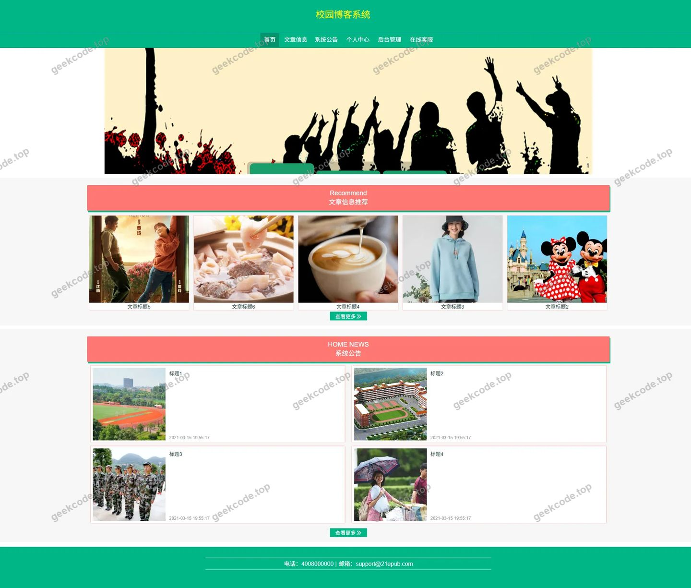</a>

<h4>前台注册页</h4>

<h4>前台登录页</h4>

<h4>前台-系统公告列表</h4>

<a href="https://geekcode.top/archives/%E6%A0%A1%E5%9B%AD%E5%8D%9A%E5%AE%A2%E7%B3%BB%E7%BB%9F?utm_source=github" title="查看完整源码">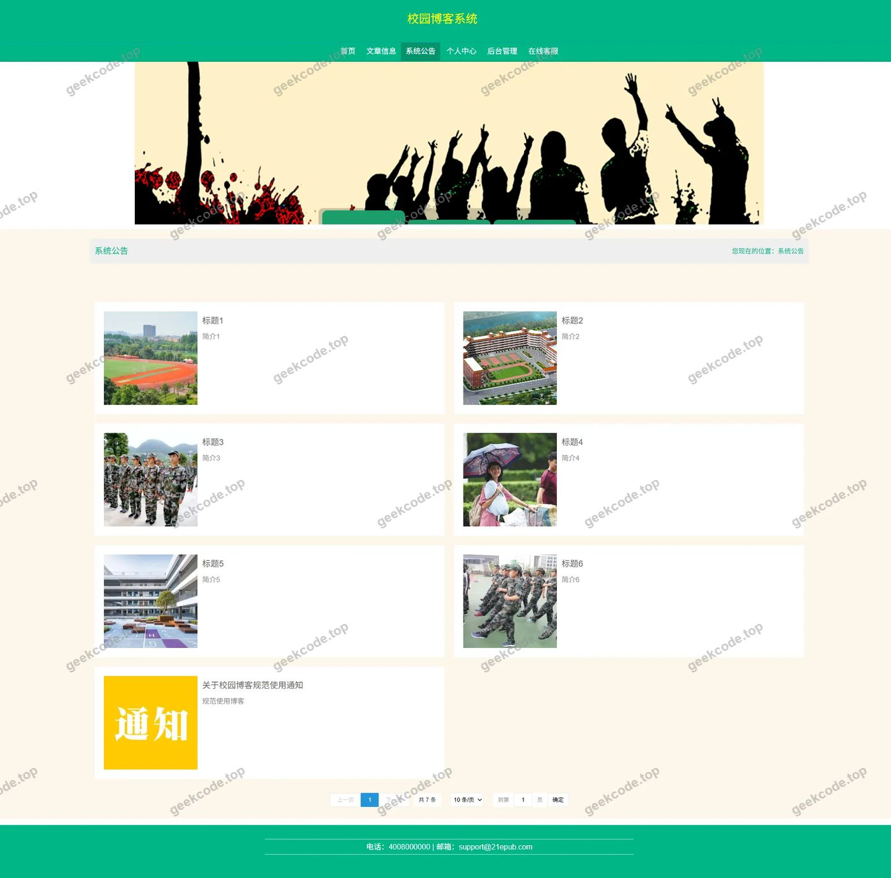</a>

<h4>前台-文章信息列表</h4>

<a href="https://geekcode.top/archives/%E6%A0%A1%E5%9B%AD%E5%8D%9A%E5%AE%A2%E7%B3%BB%E7%BB%9F?utm_source=github" title="查看完整源码">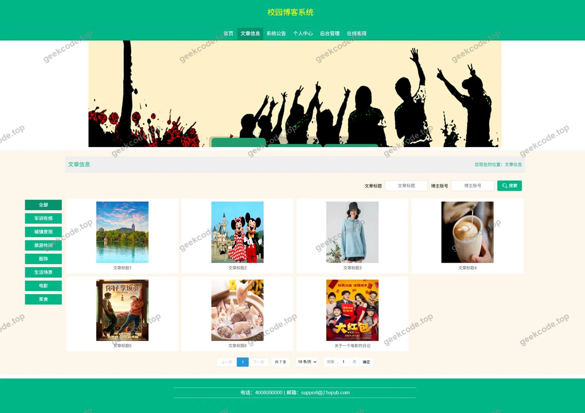</a>

<h4>前台-文章信息评论列表</h4>

<a href="https://geekcode.top/archives/%E6%A0%A1%E5%9B%AD%E5%8D%9A%E5%AE%A2%E7%B3%BB%E7%BB%9F?utm_source=github" title="查看完整源码">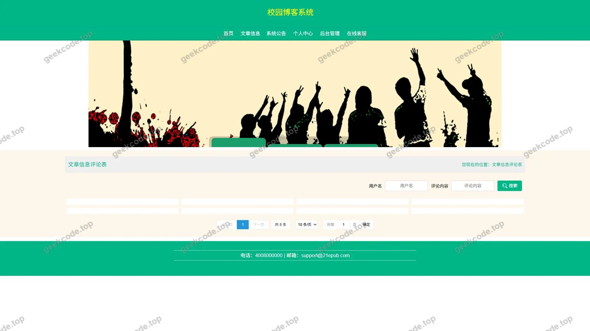</a>

<h4>前台个人中心</h4>

<a href="https://geekcode.top/archives/%E6%A0%A1%E5%9B%AD%E5%8D%9A%E5%AE%A2%E7%B3%BB%E7%BB%9F?utm_source=github" title="查看完整源码">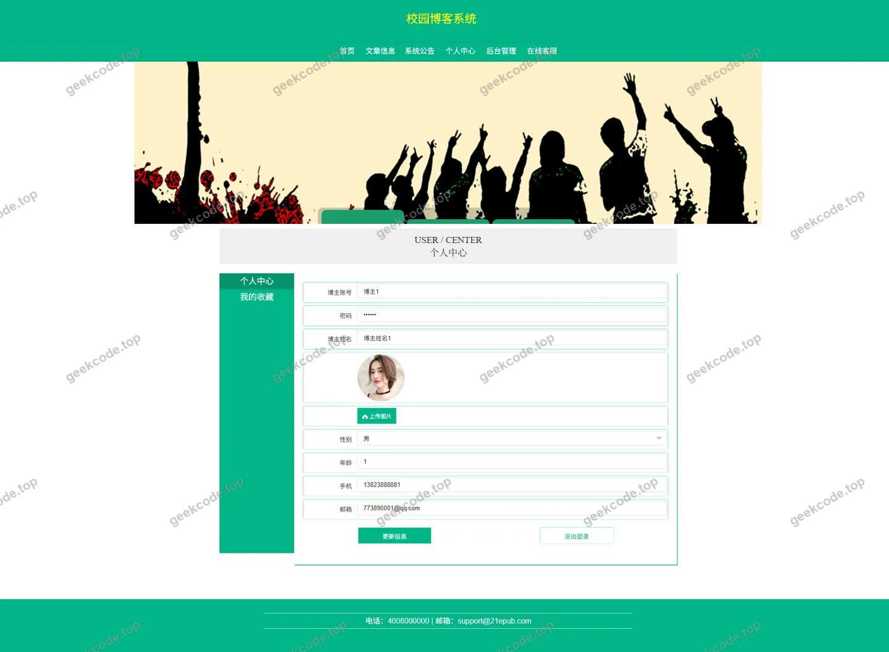</a>

<h4>前台-我的收藏列表</h4>

<a href="https://geekcode.top/archives/%E6%A0%A1%E5%9B%AD%E5%8D%9A%E5%AE%A2%E7%B3%BB%E7%BB%9F?utm_source=github" title="查看完整源码">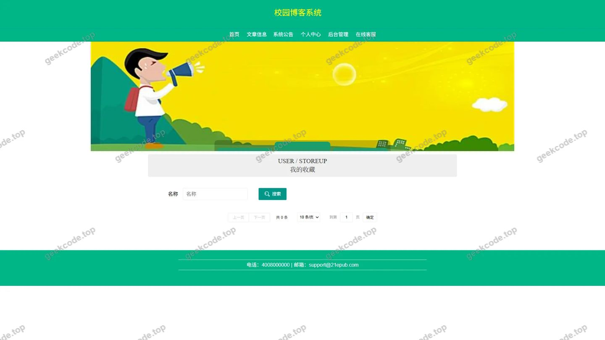</a>

<h4>前台-系统公告-详情</h4>

<a href="https://geekcode.top/archives/%E6%A0%A1%E5%9B%AD%E5%8D%9A%E5%AE%A2%E7%B3%BB%E7%BB%9F?utm_source=github" title="查看完整源码">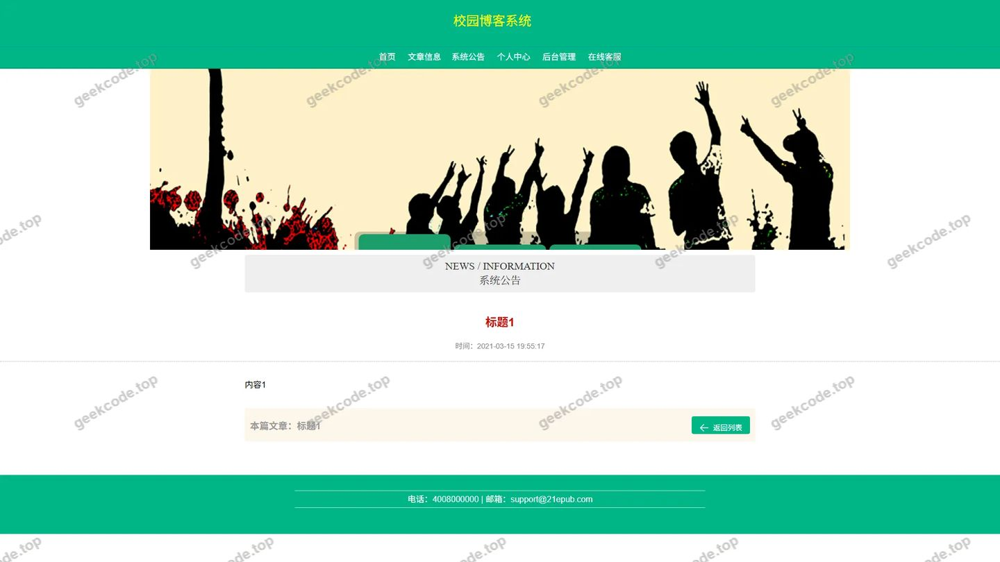</a>

<h4>前台-文章信息-详情</h4>

<a href="https://geekcode.top/archives/%E6%A0%A1%E5%9B%AD%E5%8D%9A%E5%AE%A2%E7%B3%BB%E7%BB%9F?utm_source=github" title="查看完整源码">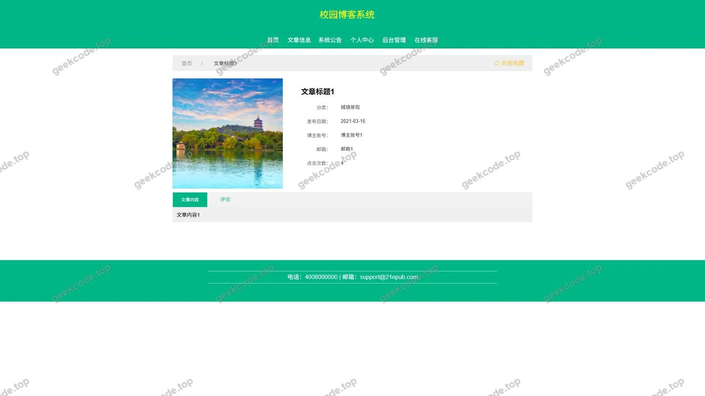</a>

<h4>前台-举报投诉列表</h4>

<a href="https://geekcode.top/archives/%E6%A0%A1%E5%9B%AD%E5%8D%9A%E5%AE%A2%E7%B3%BB%E7%BB%9F?utm_source=github" title="查看完整源码">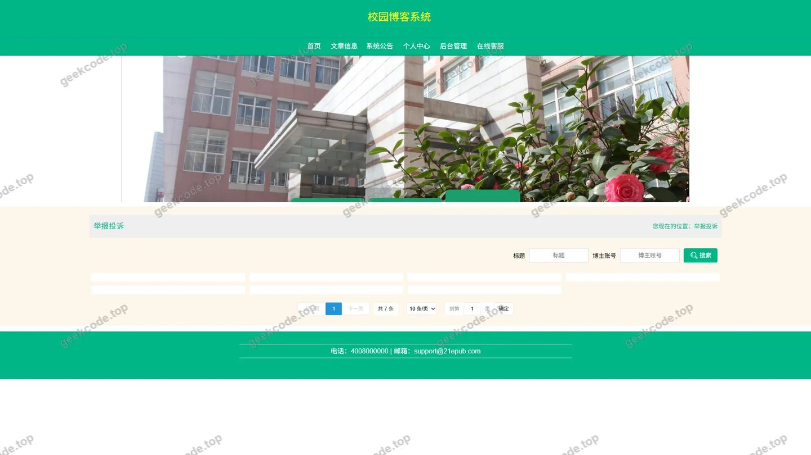</a>

<h4>前台-文章分类列表</h4>

<a href="https://geekcode.top/archives/%E6%A0%A1%E5%9B%AD%E5%8D%9A%E5%AE%A2%E7%B3%BB%E7%BB%9F?utm_source=github" title="查看完整源码">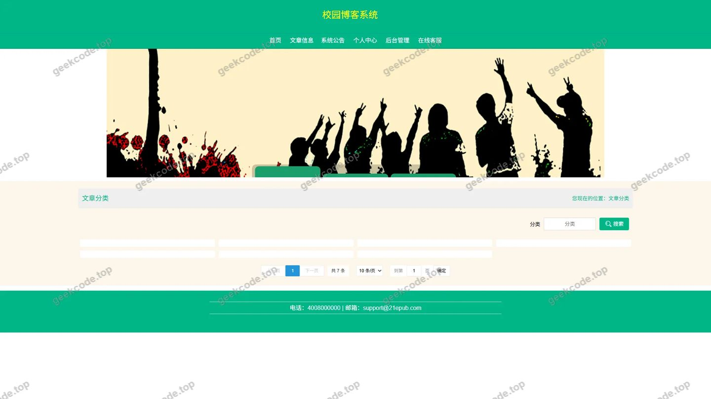</a>

<h4>前台-文章信息评论-详情</h4>

<a href="https://geekcode.top/archives/%E6%A0%A1%E5%9B%AD%E5%8D%9A%E5%AE%A2%E7%B3%BB%E7%BB%9F?utm_source=github" title="查看完整源码">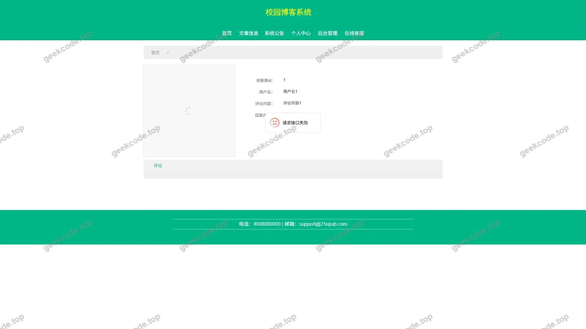</a>

<h4>前台-举报投诉-详情</h4>

<a href="https://geekcode.top/archives/%E6%A0%A1%E5%9B%AD%E5%8D%9A%E5%AE%A2%E7%B3%BB%E7%BB%9F?utm_source=github" title="查看完整源码">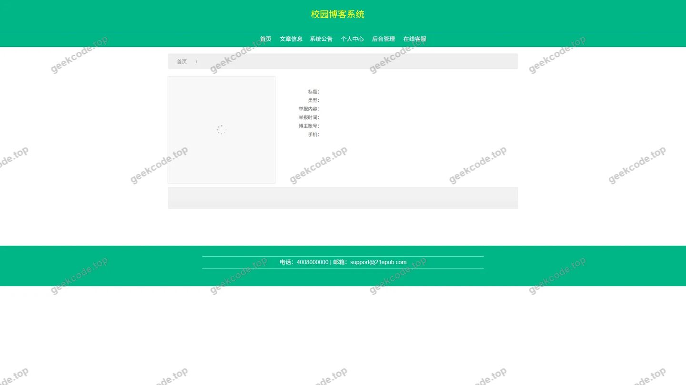</a>

<h3>后台管理端</h3>
<h4>后台-博主</h4>

<a href="https://geekcode.top/archives/%E6%A0%A1%E5%9B%AD%E5%8D%9A%E5%AE%A2%E7%B3%BB%E7%BB%9F?utm_source=github" title="查看完整源码">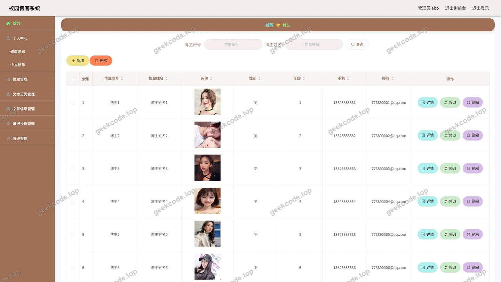</a>

<h4>后台-在线客服</h4>

<a href="https://geekcode.top/archives/%E6%A0%A1%E5%9B%AD%E5%8D%9A%E5%AE%A2%E7%B3%BB%E7%BB%9F?utm_source=github" title="查看完整源码">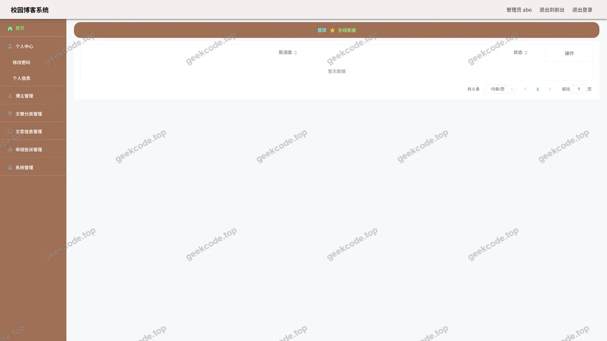</a>

<h4>后台-系统配置</h4>

<a href="https://geekcode.top/archives/%E6%A0%A1%E5%9B%AD%E5%8D%9A%E5%AE%A2%E7%B3%BB%E7%BB%9F?utm_source=github" title="查看完整源码">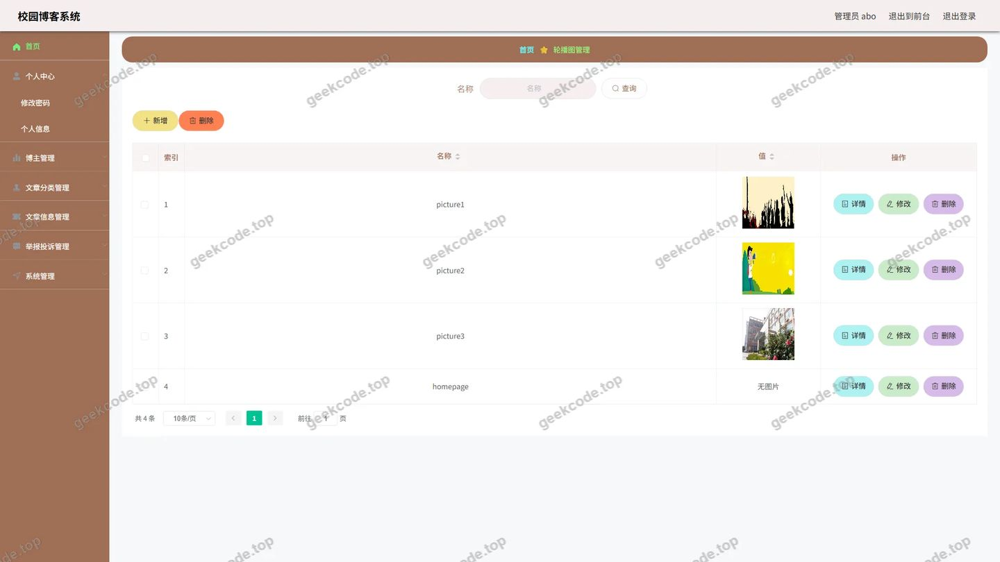</a>

<h4>后台-文章信息评论</h4>

<a href="https://geekcode.top/archives/%E6%A0%A1%E5%9B%AD%E5%8D%9A%E5%AE%A2%E7%B3%BB%E7%BB%9F?utm_source=github" title="查看完整源码">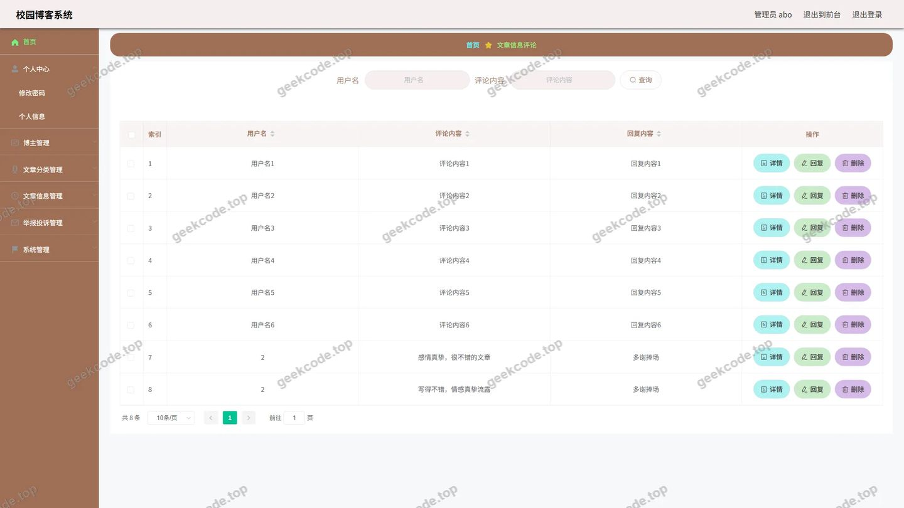</a>

<h4>后台首页</h4>

<a href="https://geekcode.top/archives/%E6%A0%A1%E5%9B%AD%E5%8D%9A%E5%AE%A2%E7%B3%BB%E7%BB%9F?utm_source=github" title="查看完整源码">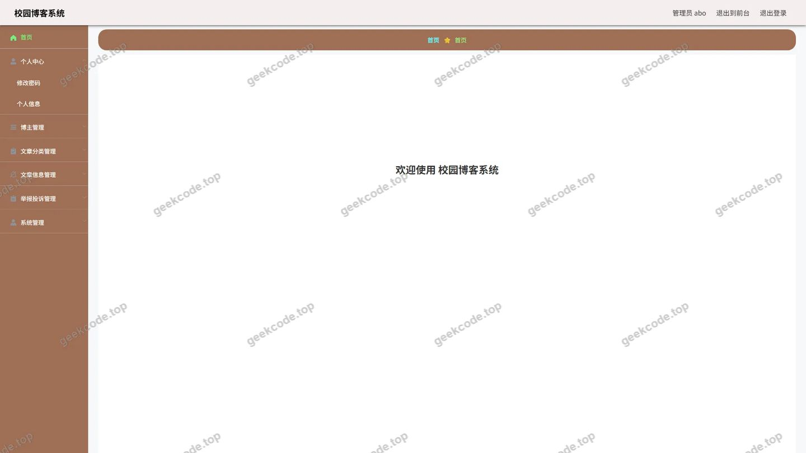</a>

<h4>后台-举报投诉</h4>

<a href="https://geekcode.top/archives/%E6%A0%A1%E5%9B%AD%E5%8D%9A%E5%AE%A2%E7%B3%BB%E7%BB%9F?utm_source=github" title="查看完整源码">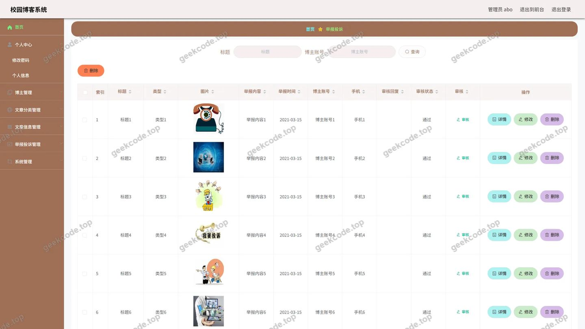</a>

<h4>后台-登录</h4>

<a href="https://geekcode.top/archives/%E6%A0%A1%E5%9B%AD%E5%8D%9A%E5%AE%A2%E7%B3%BB%E7%BB%9F?utm_source=github" title="查看完整源码">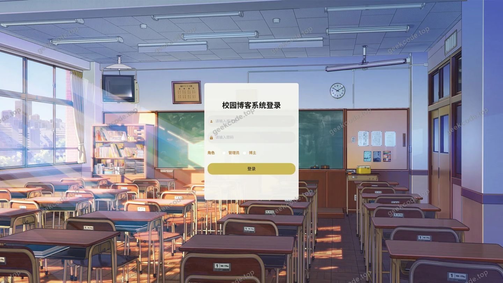</a>

<h4>后台-公告信息</h4>

<a href="https://geekcode.top/archives/%E6%A0%A1%E5%9B%AD%E5%8D%9A%E5%AE%A2%E7%B3%BB%E7%BB%9F?utm_source=github" title="查看完整源码">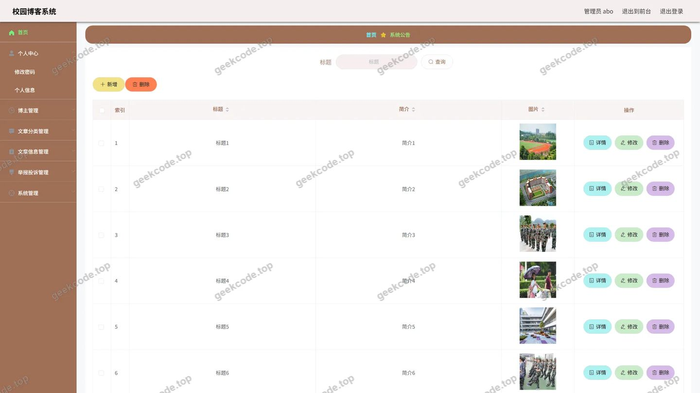</a>

<h4>后台-收藏</h4>

<a href="https://geekcode.top/archives/%E6%A0%A1%E5%9B%AD%E5%8D%9A%E5%AE%A2%E7%B3%BB%E7%BB%9F?utm_source=github" title="查看完整源码">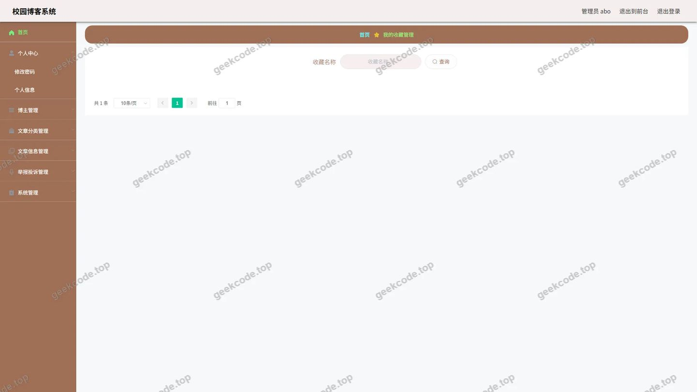</a>

<h4>后台-文章分类</h4>

<a href="https://geekcode.top/archives/%E6%A0%A1%E5%9B%AD%E5%8D%9A%E5%AE%A2%E7%B3%BB%E7%BB%9F?utm_source=github" title="查看完整源码">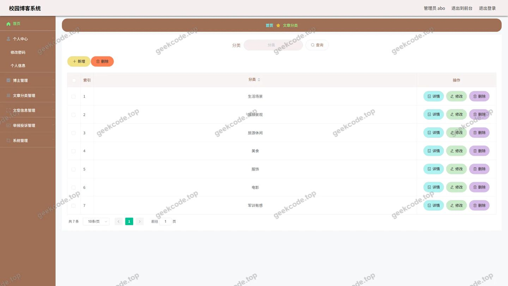</a>

<h4>后台-文章信息</h4>

<a href="https://geekcode.top/archives/%E6%A0%A1%E5%9B%AD%E5%8D%9A%E5%AE%A2%E7%B3%BB%E7%BB%9F?utm_source=github" title="查看完整源码">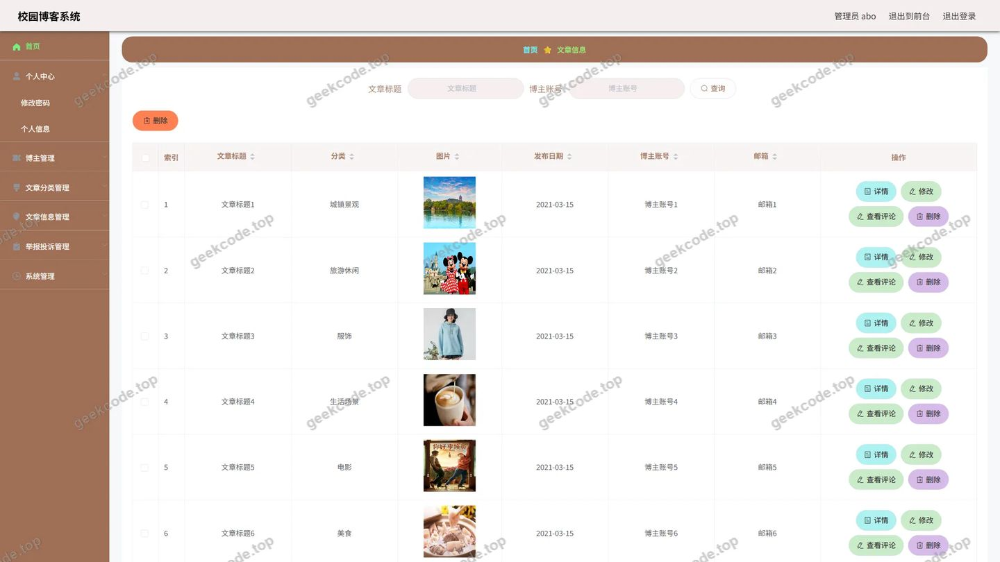</a>

---

## 获取完整源码

| 项目 | 说明 |
| --- | --- |
| 项目名 | 校园博客系统 |
| 运行截图 | 本文 25 张（站点带水印原图，仓库 `images/` 目录） |
| 完整源码 | [https://geekcode.top/archives/%E6%A0%A1%E5%9B%AD%E5%8D%9A%E5%AE%A2%E7%B3%BB%E7%BB%9F?utm_source=github](https://geekcode.top/archives/%E6%A0%A1%E5%9B%AD%E5%8D%9A%E5%AE%A2%E7%B3%BB%E7%BB%9F?utm_source=github) |
| 咨询微信 | **ir9372**（备注：jingpin-yuanma） |
| 更多项目 | [极客代码 geekcode.top](https://geekcode.top/?utm_source=github) |

> 需要源码、部署、改配置、跑不起来等问题，加微信 ir9372 沟通，说明项目名即可。
